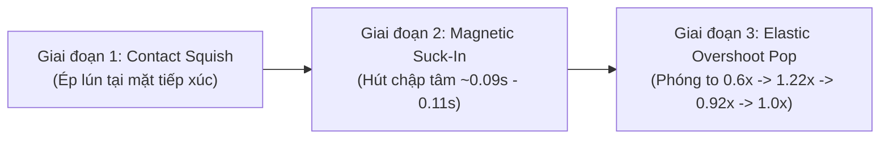
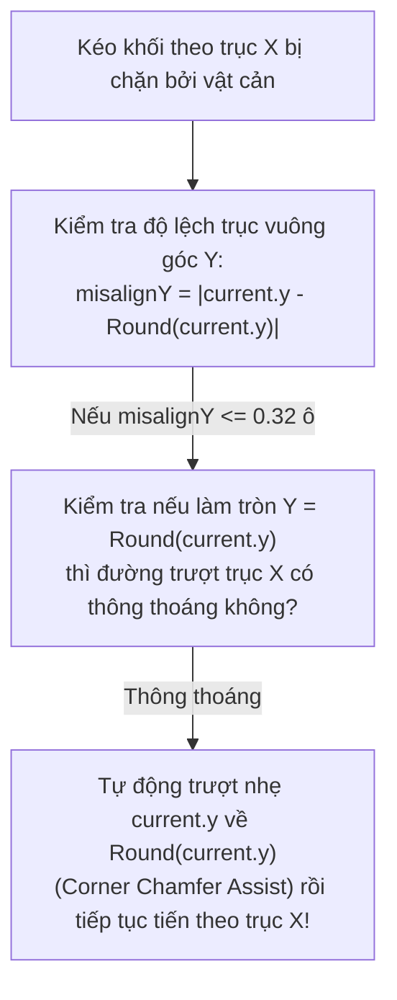

# Tài liệu Kỹ thuật: Tối ưu Game Feel, Độ Mượt Di Chuyển & Hiệu Ứng Khối Thạch 3D (Jelly Block)
**Tham chiếu Video gốc:** [YouTube Shorts `eoOOBFUVPog` - Pets Harbor](https://www.youtube.com/shorts/eoOOBFUVPog)  
**Engine mục tiêu:** Unity 6 (`6000.0.x` - URP / Built-in)  
**Liên kết Codebase hiện tại:**
- [`JellyBlock.cs`](file:///d:/Company/Cscmobi/Projects/G23/REA/Demo%20Game%20From%20Creative/Pets%20Harbor/Assets/_Game/Scripts/Gameplay/JellyBlock.cs)
- [`BlockDragController.cs`](file:///d:/Company/Cscmobi/Projects/G23/REA/Demo%20Game%20From%20Creative/Pets%20Harbor/Assets/_Game/Scripts/Gameplay/BlockDragController.cs)
- [`BoardGridManager.cs`](file:///d:/Company/Cscmobi/Projects/G23/REA/Demo%20Game%20From%20Creative/Pets%20Harbor/Assets/_Game/Scripts/Core/BoardGridManager.cs)

---

## PHẦN 1: PHÂN TÍCH GAME FEEL & ĐỘ MƯỢT TRONG VIDEO GỐC (`eoOOBFUVPog`)

Sự "đã tay" (tactile satisfaction) và mướt mắt trong video quảng cáo gốc đến từ sự phối hợp đồng bộ giữa **Điều khiển (Input)**, **Va chạm vật lý giả lập (Sub-grid Collision)**, **Biến dạng đàn hồi (Soft-body / Squash & Stretch)** và **Chất liệu ánh sáng (Translucent Shader)**.

### 1.1. Cảm giác Kéo Trượt (Movement & Drag Feel)
1. **Di chuyển liên tục dưới cấp độ ô lưới (Continuous Sub-Grid Sliding):**
   - Bàn cờ chia lưới $7 \times 8$, nhưng khối thạch **không bao giờ nhảy từng ô** trong lúc kéo. Vị trí của khối là số thực `(float GridX, float GridY)` bám theo ngón tay với độ trễ lò xo cực nhỏ ($\sim 16\text{ms} - 25\text{ms}$), tạo cảm giác khối có khối lượng vật lý thật nhưng vẫn cực kỳ nhạy.
2. **Trượt bo góc & Lách khe hẹp (Corner Chamfer / Edge-Slide Assist):**
   - *Quan sát tại `00:05 – 00:13`:* Khi bàn tay kéo các khối `1x1` và `2x1` đi theo đường chữ L (kéo ngang rồi bẻ lên dọc), dù quỹ đạo ngón tay đi vòng cung và quệt vào góc của khối bên cạnh, khối thạch vẫn **tự động trượt bo qua góc** để chui tọt vào khe trống mà không bị khựng lại.
3. **Hút nam châm êm ái vào rãnh lưới (Soft Magnetic Lane & Cell Snap):**
   - Khi thả tay hoặc khi dừng kéo, khối không giật cục về tọa độ nguyên `(int col, int row)` mà trượt êm về tâm ô bằng đường cong giảm tốc (`Cubic Ease-Out` trong `0.08s – 0.10s`).

### 1.2. Cảm giác Va Chạm & Hợp Nhất 3 Giai Đoạn (3-Stage Merge Choreography)
Quan sát các pha ghép nối tiếp ở `00:01 – 00:04`, `00:15 – 00:16`, `00:23 – 00:24`:



1. **Giai đoạn 1 – Ép lún tiếp xúc (Pre-Merge Contact Squish):**
   - Khi kéo khối $A$ chạm vào khối $B$ cùng cấp (ví dụ 2 khối Đỏ `2x2` tại `00:23`), chúng không biến mất ngay lập tức ở khoảnh khắc vừa chạm mép ngoài. Khối $A$ lún nhẹ vào khối $B$, hai bề mặt tiếp xúc bị nén dẹt lại theo trục va chạm và phình nhẹ ra trục vuông góc.
2. **Giai đoạn 2 – Hút chập tâm (Magnetic Fusion / Suck-In):**
   - Khi độ lún vượt ngưỡng ($\sim 35\% - 45\%$ ô), lực hút nam châm kích hoạt: cả hai khối cùng co rút nhanh về tâm của khối mới trong khoảng `0.09s – 0.11s`.
3. **Giai đoạn 3 – Nảy phồng Tiến hóa (Volume-Preserving Jelly Pop):**
   - Khối cấp mới ($k+1$) bung ra từ lõi nén ($0.58\times$), vọt qua kích thước chuẩn lên $1.22\times$ (Overshoot), thu về $0.90\times$ (Undershoot), rồi nảy nhẹ về $1.00\times$.

### 1.3. Biến Dạng Quán Tính & Chất Liệu Thạch (Visual & Material Polish)
1. **Biến dạng nghiêng và kéo giãn theo vận tốc (Velocity Shear & Stretch):**
   - Ở các pha vẩy tay nhanh (`00:12`, `00:14`, `00:26`), mặt trên của khối thạch hơi **nghiêng trễ pha** so với mặt đáy và giãn dài khoảng $5\% - 8\%$ theo hướng kéo.
2. **Khuôn mặt biểu cảm nằm "bên dưới" lớp thạch bóng (Sub-Coat Facial Expression):**
   - Mắt, miệng, má hồng không giống một tờ giấy dán đè lên trên mà nằm **bên dưới lớp phản xạ bóng kính (Specular / Clear Coat)**. Vệt sáng trắng ở gờ khối chạy xuyên qua cả biểu cảm khuôn mặt, và khi khối thạch phình/lún thì mắt miệng cũng co giãn theo.
3. **Độ trong mờ dưới da & Bóng đổ tiếp xúc (Subsurface Scattering & Contact Shadow):**
   - Ánh sáng xuyên qua rìa khối tạo viền sáng màu ấm (Fresnel / SSS), trong khi đáy khối tiếp giáp mặt khay gỗ có viền bóng tối mềm (Ambient Occlusion / Drop Shadow) giúp khối không bị cảm giác "bay lơ lửng".

---

## PHẦN 2: CÁC THƯ VIỆN UNITY KHUYÊN DÙNG

Để tiết kiệm thời gian và đạt chuẩn đồ họa / chuyển động của các studio lớn, bạn có thể sử dụng kết hợp các thư viện sau:

| Nhóm Nhu Cầu | Thư Viện Khuyên Dùng | Vai Trò Cụ Thể Trong Game Này |
| :--- | :--- | :--- |
| **1. Tweening & Chuỗi Chuyển Động** | **[PrimeTween](https://assetstore.unity.com/packages/tools/animation/primetween-high-performance-animations-and-sequences-252960)** *(Khuyên dùng #1)* hoặc **[DOTween Pro](https://assetstore.unity.com/packages/tools/visual-scripting/dotween-pro-32416)** | - Chạy chuỗi `Sequence` khi Merge (*Suck-In* $\rightarrow$ *Pop*).<br>- Chạy `Tween.PunchScale` / `DOShakeScale` không tạo rác bộ nhớ (Zero GC Allocation).<br>- Hỗ trợ `AnimationCurve` tùy chỉnh độ nảy. |
| **2. Hiệu Ứng Đàn Hồi Đỉnh Mesh (Soft-body Jiggle)** | **[Boing Kit](https://assetstore.unity.com/packages/tools/particles-effects/boing-kit-135594)** | - Tạo hiệu ứng lắc lư vật lý (Spring-based Vertex/Transform Boing Behavior) cho phần thân trên của viên thạch khi tăng tốc hoặc dừng đột ngột mà không cần dùng `MeshCollider` hay `Softbody Physics` nặng nề. |
| **3. Game Feel & Juice Tổng Hợp** | **[Feel (More Mountains)](https://assetstore.unity.com/packages/tools/particles-effects/feel-183370)** | - Cung cấp sẵn component `MMF_SquashAndStretch`, `MMF_PositionSpring`, `MMF_Haptics` (rung phản hồi trên điện thoại) và quản lý Sound Pitch tăng dần khi Combo Merge. |
| **4. Shader & Stylize Lighting** | **Unity URP Shader Graph** *(Có sẵn)* hoặc **[Flat Kit](https://assetstore.unity.com/packages/vfx/shaders/flat-kit-toon-shading-and-water-143368)** | - Tạo Shader Jelly có *Clear Coat* (lớp phủ bóng trong suốt), *Fresnel Rim*, *Fake Subsurface Scattering* và *Vertex Shear Deformation*. |

---

## PHẦN 3: 6 KỸ THUẬT LẬP TRÌNH CỐT LÕI (KÈM CÔNG THỨC & CODE MẪU)

Ngay cả khi tự code hoàn toàn trong Unity mà không mua Asset trả phí, bạn có thể đạt **100% độ mượt của video** bằng 6 kỹ thuật dưới đây:

---

### Kỹ Thuật 1: Hệ Lò Xo Giảm Chấn Bậc 2 (Second-Order Spring Damper)

Thay vì dùng `Vector3.Lerp` đơn thuần (vốn chỉ có vận tốc giảm dần, thiếu quán tính văng nhẹ khi dừng), hãy dùng bộ giải **Second-Order Dynamics** (phổ biến từ bài toán *Procedural Animation* của *t3ssel8r*) cho cả **Vị trí khối** và **Vận tốc nghiêng**:

$$\ddot{y} + \frac{2\zeta}{\omega} \dot{y} + y = x + \frac{r \zeta}{\omega} \dot{x}$$

Trong đó:
- $f$ (`frequency` $\approx 8.5\text{ Hz}$): Tốc độ phản hồi khi kéo.
- $\zeta$ (`damping` $\approx 0.68$): Hệ số cản ($\zeta < 1$ giúp khối hơi nhún nhẹ qua vị trí dừng rồi mới đứng yên).
- $r$ (`response` $\approx 1.2$): Độ nhạy tức thời ngay khi bắt đầu kéo.

```csharp
[System.Serializable]
public struct SpringVector3
{
    private Vector3 _xp; // Input frame trước
    private Vector3 _y;  // Giá trị đầu ra hiện tại
    private Vector3 _yd; // Vận tốc đầu ra hiện tại
    private float _k1, _k2, _k3;

    public void Configure(float frequency, float damping, float response, Vector3 initialValue)
    {
        _k1 = damping / (Mathf.PI * frequency);
        _k2 = 1f / ((2f * Mathf.PI * frequency) * (2f * Mathf.PI * frequency));
        _k3 = response * damping / (2f * Mathf.PI * frequency);
        _xp = _y = initialValue;
        _yd = Vector3.zero;
    }

    public Vector3 Step(float dt, Vector3 x)
    {
        if (dt <= 0.0001f) return _y;
        Vector3 xd = (x - _xp) / dt;
        _xp = x;
        float k2Stable = Mathf.Max(_k2, 1.1f * (dt * dt * 0.25f + dt * _k1 * 0.5f));
        _y += dt * _yd;
        _yd += dt * (x + _k3 * xd - _y - _k1 * _yd) / k2Stable;
        return _y;
    }
}
```

---

### Kỹ Thuật 2: Bảo Toàn Thể Tích khi Squash & Stretch (Volume-Preserving Deformation)

Trong tự nhiên, thạch rau câu là vật chất không nén được (incompressible) — thể tích $V = S_x \times S_y \times S_z$ luôn bằng hằng số $1.0$:
$$S_y = \frac{1.0}{S_x \cdot S_z}$$

- Khi kéo nhanh theo trục $X$ với độ giãn $S_x = 1 + \epsilon$, hai trục còn lại phải tự động thu nhỏ:
  $$S_z = \frac{1}{\sqrt{1 + \epsilon}}, \quad S_y = \frac{1}{\sqrt{1 + \epsilon}}$$
- Khi 2 khối ép vào nhau theo trục $X$ ($S_x = 1 - c$), trục $Z$ và $Y$ tự động phồng ra $\frac{1}{\sqrt{1 - c}}$. Quy tắc này giúp viên thạch nhìn "mọng nước" và chân thực hơn hẳn phép cộng/trừ tuyến tính.

---

### Kỹ Thuật 3: Biến Dạng Nghiêng Thân Theo Quán Tính (Velocity Tilt & Top-Surface Shear)

Khi người chơi vẩy khối thạch sang ngang/dọc, mặt đáy của viên thạch ma sát với khay gỗ còn mặt trên bị văng theo quán tính. Có 2 cách cài đặt trong [`JellyBlock.cs`](file:///d:/Company/Cscmobi/Projects/G23/REA/Demo%20Game%20From%20Creative/Pets%20Harbor/Assets/_Game/Scripts/Gameplay/JellyBlock.cs):

1. **Cách 1 – Nghiêng & Trượt nhẹ `FaceDecal` + `VisualRoot` bằng C#:**
   - Khi có vận tốc lò xo $\vec{v} = (v_x, v_z)$:
     - Nghiêng nhẹ `_visualRoot.localRotation` một góc `Quaternion.Euler(vz * 1.8f, 0f, -vx * 1.8f)`.
     - Dịch chuyển nhẹ tâm biểu cảm `FaceDecal` lệch về hướng di chuyển một khoảng $\Delta = \text{Clamp}(\vec{v} \times 0.012, -0.06, 0.06)$ để tạo hiệu ứng thị sai 3D (Parallax) bên trong khối thạch.

2. **Cách 2 – Biến dạng trượt (Shear) trực tiếp trong Vertex Shader (HLSL):**
   - Truyền vector `_JellyShearXZ` (được tính từ lò xo vận tốc) vào `MaterialPropertyBlock`.
   - Trong Vertex Shader, dịch chuyển đỉnh dựa theo chiều cao chuẩn hóa $h = \text{saturate}(v.\text{positionOS}.y / \text{BlockThickness})$:
     ```hlsl
     float heightFactor = h * h; // Đáy (h=0) cố định, Đỉnh (h=1) nghiêng mạnh nhất
     v.positionOS.xz += _JellyShearXZ.xy * heightFactor;
     ```

---

### Kỹ Thuật 4: Thuật Toán Trượt Bo Góc & Trợ Lực Lách Khe (Corner Chamfer & Lane Assist)

Đây là bí quyết quan trọng nhất trong [`BoardGridManager.cs`](file:///d:/Company/Cscmobi/Projects/G23/REA/Demo%20Game%20From%20Creative/Pets%20Harbor/Assets/_Game/Scripts/Core/BoardGridManager.cs) để khi người chơi kéo chữ L qua khe hẹp mà **không bao giờ bị vấp góc**:



- **Nguyên lý hoạt động:**
  - Giả sử người chơi đang kéo khối sang Phải ($\Delta x > 0$) để chui vào một hẻm ngang ở hàng `row = 2`, nhưng ngón tay người chơi đang giữ lệch ở `current.y = 2.22` nên cạnh dưới của khối bị vướng nhẹ ($0.22$ ô) vào khối ở hàng `row = 3`.
  - Khi bước di chuyển theo trục $X$ bị chặn, kiểm tra ô nguyên gần nhất `snappedY = Mathf.Round(current.y)`. Nếu `Mathf.Abs(current.y - snappedY) <= 0.32f` và tại `(nextX, snappedY)` **không có vật cản**, hệ thống tự động kéo mượt `current.y` về `snappedY` với tốc độ phụ trợ rồi cho phép khối trượt tiếp sang `nextX`.
  - Kết quả: Khối thạch tự "lách" qua góc vuông mượt như bơ giống hệt giây `00:08 – 00:10` trong video gốc!

---

### Kỹ Thuật 5: Hòa Trộn Biểu Cảm Emoji Nằm Dưới Lớp Bóng Kính (Under-Coat Facial Blending)

Trong [`JellyBlock.cs`](file:///d:/Company/Cscmobi/Projects/G23/REA/Demo%20Game%20From%20Creative/Pets%20Harbor/Assets/_Game/Scripts/Gameplay/JellyBlock.cs#L86-L95) hiện tại, khuôn mặt Emoji đang là một `Quad` (`FaceDecal`) dùng shader `Unlit/Transparent` đặt cao hơn mặt thạch `0.018f`. Cách này dễ làm nhưng có 2 nhược điểm:
1. Mặt `Quad` phẳng không có độ phồng vòm (Pillow Top) như đỉnh viên thạch.
2. Ánh sáng bóng kính (Specular highlight) của viên thạch bị `Quad` che khuất.

**Giải pháp nâng cấp chuẩn Studio:**
- **Cách A (Gộp vào cùng Texture/Shader của khối thạch):**
  - Khi khởi tạo chất liệu cho mỗi Tier, gộp (composite) trực tiếp Texture `EmojiFace` lên vùng tâm của `JellyBodyTexture` (hoặc dùng 2 kênh texture `_BaseMap` + `_FaceDecalMap` trong cùng 1 Shader `Lit`).
  - Nhờ đó, toàn bộ mắt, miệng, má hồng sẽ nằm **trên chính lưới 3D vòm cong của đỉnh thạch** và nằm **dưới lớp Specular (`Smoothness = 0.90`) + Rim Light**, giúp ánh sáng phản chiếu bóng loáng phủ lên trên cả khuôn mặt!
- **Cách B (Nếu giữ `FaceDecal` riêng):**
  - Dùng lưới vòm cong (Curved Top Mesh) thay cho `Quad` phẳng và đổi Shader của `FaceDecal` sang `Lit Transparent` (hoặc nhân thêm lớp Rim Highlight giả lập) để đồng bộ ánh sáng.

---

### Kỹ Thuật 6: Bóng Đổ Tiếp Xúc Đáy Khay (Soft Contact Drop Shadow) & Âm Thanh Leo Thang

1. **Bóng tiếp xúc (Contact Ambient Occlusion Blob):**
   - Thêm một tấm `ShadowQuad` mỏng màu nâu đen bán trong suốt (`Alpha = 0.28`, viền mờ dần bằng Radial Gradient) nằm sát mặt sàn khay gỗ (`y = 0.005f`) ngay dưới bụng mỗi khối thạch.
   - Khi khối thạch được nhấc nhẹ lên lúc kéo (`y = 0.05f`), bóng đổ hơi mở rộng và nhạt đi một chút; khi khối thạch nảy xuống, bóng đổ đậm lại. Hiệu ứng nhỏ này tăng cảm giác chiều sâu 3D lên gấp đôi.
2. **Âm thanh thạch & Tăng cao độ theo cấp (Pitch-Scaled Jelly Audio):**
   - Khi bắt đầu chạm khối: Phát âm thanh *Pop/Squish* trầm nhẹ (`pitch = 0.95`).
   - Khi Merge lên cấp `Tier k`: Tăng dần `pitch = 0.85f + k * 0.06f` để chuỗi Merge liên hoàn tạo cảm giác hưng phấn (Dopamine rush).

---

## PHẦN 4: BẢNG SO SÁNH HIỆN TRẠNG PROJECT & ĐỀ XUẤT NÂNG CẤP

| Hạng Mục | Hiện Trạng Trong Project (`Pets Harbor`) | Đề Xuất Nâng Cấp Để Đạt 100% Như Video |
| :--- | :--- | :--- |
| **Theo dõi vị trí kéo** | `Vector3.Lerp` hàm mũ (`Exp(-38 * dt)`) trong [`JellyBlock.cs`](file:///d:/Company/Cscmobi/Projects/G23/REA/Demo%20Game%20From%20Creative/Pets%20Harbor/Assets/_Game/Scripts/Gameplay/JellyBlock.cs#L300). | Thêm **Second-Order Spring** + **Velocity Tilt** (nghiêng nhẹ thân khối `1.5° - 3°` theo vận tốc kéo). |
| **Lách góc hẹp (Corner Slide)** | Swept AABB tách trục $X, Y$ trong [`BoardGridManager.cs`](file:///d:/Company/Cscmobi/Projects/G23/REA/Demo%20Game%20From%20Creative/Pets%20Harbor/Assets/_Game/Scripts/Core/BoardGridManager.cs#L291-L335). | Bổ sung **Corner Chamfer Assist**: tự động căn chỉnh trục vuông góc khi vướng mép $\le 0.30$ ô để lách khe chữ L mượt mà. |
| **Hiệu ứng Squash & Stretch** | Cộng/trừ tuyến tính `sx, sy, sz` trong [`JellyBlock.cs`](file:///d:/Company/Cscmobi/Projects/G23/REA/Demo%20Game%20From%20Creative/Pets%20Harbor/Assets/_Game/Scripts/Gameplay/JellyBlock.cs#L353-L390). | Áp dụng công thức **Bảo toàn thể tích** ($S_y = \frac{1}{S_x \cdot S_z}$) để khối thạch phồng/xẹp tự nhiên hơn. |
| **Hiển thị Mặt Emoji** | `Quad` phẳng `Unlit/Transparent` đặt trên đỉnh khối trong [`JellyBlock.cs`](file:///d:/Company/Cscmobi/Projects/G23/REA/Demo%20Game%20From%20Creative/Pets%20Harbor/Assets/_Game/Scripts/Gameplay/JellyBlock.cs#L87-L95). | Hòa trộn trực tiếp `FaceTexture` vào Texture đỉnh của `JellyBoxMesh` (dưới lớp `Lit Smoothness = 0.90`) để mặt cong theo vòm thạch và bắt sáng bóng kính. |
| **Bóng tiếp xúc đáy khay** | Chỉ dùng Directional Light Shadow mặc định. | Thêm **Soft Contact Shadow Blob** dưới đáy mỗi viên thạch để tách biệt rõ khối 3D với mặt khay gỗ. |

---

## PHẦN 5: PHÂN TÍCH CƠ CHẾ LỰC ĐẨY & QUÁN TÍNH TRƯỢT (VELOCITY-DRIVEN PUSH & GLIDE)

Khi phân tích kỹ video gốc và đối chiếu với thao tác chuột thực tế (`Recording 2026-10-28 161214.mp4` & `163249.mp4`), điểm khác biệt cốt lõi tạo nên cảm giác **"đẩy nhẹ đi ngắn, đẩy mạnh đi dài, như truyền lực thật vào viên thạch"** nằm ở 3 cơ chế vật lý sau:

1. **Bộ Nhớ Đỉnh Vận Tốc Cửa Sổ Ngắn (`Peak Push Velocity Window ~75ms`):**
   - Trong thực tế, khi người chơi vẩy chuột nhanh rồi nhả nút chuột (`MouseUp`), bàn tay thường khựng lại khoảng `1–2 frame` (`16ms–33ms`) ngay khoảnh khắc nhả ngón tay. Nếu chỉ lấy vận tốc ở đúng frame nhả chuột, vận tốc thường tụt về `0` khiến viên thạch đứng khựng lại.
   - **Giải pháp trong [`BlockDragController.cs`](file:///d:/Company/Cscmobi/Projects/G23/REA/Demo%20Game%20From%20Creative/Pets%20Harbor/Assets/_Game/Scripts/Gameplay/BlockDragController.cs):** Lưu trữ vận tốc đỉnh trong cửa sổ `~75ms` (`_recentPushVelocity` giảm dần chậm với `decayRate = 13.5f`). Khi nhả chuột, khối thạch nhận đúng lực vẩy mạnh nhất vừa thực hiện.

2. **Khuếch Đại Lực Đẩy Tỷ Lệ Với Tốc Độ Chuột (`Velocity-Sensitive Push Gain`):**
   - Khi di chuyển chuột chậm ($v < 3.5\text{ ô/s}$), hệ số khuếch đại bằng `1.0` để người chơi đặt khối chính xác từng ô.
   - Khi vẩy chuột nhanh ($v > 3.5\text{ ô/s}$), độ nhạy đẩy tăng dần theo công thức:
     $$\text{pushGain} = 1.0 + \text{Clamp01}\left(\frac{v - 3.5}{18.0}\right) \times (\text{pushForcePower} \times 0.42)$$
   - Nhờ đó, một cú hất chuột nhẹ nhàng sẽ đẩy viên thạch vọt đi nhanh và thanh thoát hơn hẳn kéo tĩnh.

3. **Trượt Quán Tính Đa Ô Có Ma Sát (`Multi-Cell Momentum Coasting`):**
   - Khi thả chuột với vận tốc vượt ngưỡng (`> 1.8 ô/s`), thay vì khóa cứng vào ô gần nhất ngay lập tức, [`BoardGridManager.LaunchBlockCoasting`](file:///d:/Company/Cscmobi/Projects/G23/REA/Demo%20Game%20From%20Creative/Pets%20Harbor/Assets/_Game/Scripts/Core/BoardGridManager.cs) kích hoạt Coroutine trượt quán tính theo từng frame:
     - Vận tốc ban đầu: $\vec{v}_0 = \vec{v}_{\text{push}} \times (0.55 + \text{pushForcePower} \times 0.45)$.
     - Mỗi frame, khối thạch trượt qua các ô trống theo hàm `SlideBlockContinuous`, tự động căn thẳng hàng vào rãnh (`LaneCentering`), tự nảy nhẹ nếu chạm tường và **tự động kích hoạt Merge ngay trên đường trượt** nếu tông trúng khối cùng cấp!
     - Vận tốc giảm dần tự nhiên theo ma sát mặt khay (`slideFriction`). Khi tốc độ giảm xuống dưới `1.35 ô/s`, nam châm tâm ô sẽ hút êm khối thạch vào đúng tâm ô nguyên gần nhất.

---

## PHẦN 6: LƯU TRỮ BẢNG THÔNG SỐ CẤU HÌNH GAME FEEL (`GameFeelConfig`)

### 6.1. Bảng 6 Thanh Trượt Cốt Lõi Đã Co Gọn (6 Master Sliders trong [`GameFeelConfig.cs`](file:///d:/Company/Cscmobi/Projects/G23/REA/Demo%20Game%20From%20Creative/Pets%20Harbor/Assets/_Game/Scripts/Core/GameFeelConfig.cs))

Để dễ dàng tinh chỉnh trực tiếp trong Editor (`PetsHarbor -> Game Feel Tuner (Sliders)` hoặc trên `GameManager` Inspector), toàn bộ hệ thống vật lý đã được gom gọn thành **6 thanh trượt chủ đạo**:

| STT | Tên Biến (`GameFeelConfig`) | Khoảng Giá Trị | Chuẩn Cân Bằng (Default) | Preset Siêu Trơn (Ice Glide) | Preset Hút Grid Mạnh (Magnetic) | Ý Nghĩa Tác Động |
| :-: | :--- | :---: | :---: | :---: | :---: | :--- |
| **1** | `pushForcePower` | `0.0 – 3.0` | **`1.40`** | `2.10` | `1.10` | **Lực đẩy vẩy tay:** Quyết định độ văng theo lực chuột. Kéo nhẹ đi 1 ô, vẩy mạnh trượt dài nhiều ô. |
| **2** | `slideFriction` | `2.0 – 25.0` | **`7.50`** | `4.20` | `11.00` | **Ma sát mặt khay:** Càng nhỏ thì khối thạch trượt quán tính càng xa như trên mặt băng; càng lớn thì dừng lại càng nhanh. |
| **3** | `dragResponsiveness` | `15.0 – 90.0` | **`60.0`** | `78.0` | `55.0` | **Độ nhạy bám chuột:** Tốc độ viên thạch bám sát con trỏ chuột khi đang giữ kéo. |
| **4** | `gridMagnetStrength` | `0.0 – 1.0` | **`0.72`** | `0.48` | `0.95` | **Lực hút rãnh & tâm ô:** Giữ viên thạch luôn đi thẳng trong rãnh ngang/dọc và hút êm vào tâm ô khi di chuyển chậm. |
| **5** | `cornerSlideAssist` | `0.0 – 1.0` | **`0.85`** | `0.98` | `0.80` | **Trợ lực lách góc chữ L:** Tự động bo tròn qua mép các khối cản khi cua gấp vào hẻm hẹp. |
| **6** | `mergeSensitivity` | `0.2 – 1.0` | **`0.82`** | `0.90` | `0.78` | **Độ nhạy hút Merge:** Khoảng cách và tốc độ tự hút chập 2 khối cùng cấp khi trượt chạm nhau. |

---

### 6.2. Bảng Tham Chiếu Chi Tiết 17 Thông Số Vật Lý Nội Bộ (Lưu Trữ Đầy Đủ)

Dưới đây là bảng lưu trữ toàn bộ 17 thông số chi tiết bên dưới hệ thống và công thức quy đổi tự động từ 6 thanh trượt chủ đạo trong [`GameFeelConfig.cs`](file:///d:/Company/Cscmobi/Projects/G23/REA/Demo%20Game%20From%20Creative/Pets%20Harbor/Assets/_Game/Scripts/Core/GameFeelConfig.cs):

| Nhóm | Tên Thông Số Nội Bộ | Giá Trị Chuẩn Trước Đây | Công Thức Quy Đổi Từ 6 Slider Chính | Giải Thích Kỹ Thuật |
| :--- | :--- | :---: | :--- | :--- |
| **1. Bám Chuột & Dây Dẫn** | `DragFollowSharpness` | `58.0` | `= dragResponsiveness` | Hệ số hàm mũ `1 - Exp(-sharpness * dt)` cập nhật vị trí 3D. |
| | `MaxWallLeashCells` | `0.60 ô` | `Lerp(1.1f, 0.45f, InverseLerp(15, 90, dragResponsiveness))` | Giới hạn khoảng cách dây dẫn ảo khi kéo xuyên vào tường để đổi hướng không bị trễ. |
| | `maxSlideStepPerFrame` | `0.85 ô` | `0.95 ô` (cố định tối ưu) | Bước nhảy Swept AABB tối đa mỗi frame. |
| **2. Hút Rãnh & Bo Góc** | `LaneCenteringStrength` | `20.0` | `Lerp(6f, 28f, gridMagnetStrength)` | Lực kéo trục phụ về rãnh nguyên gần nhất khi đang trượt nhanh theo trục chính. |
| | `IdleMagneticPullStrength` | `12.5` | `Lerp(0f, 18f, gridMagnetStrength)` | Lực hút nhẹ tâm khối về tâm ô khi di chuyển chậm. |
| | `IdleMagneticSpeedThreshold` | `4.2 ô/s` | `Lerp(1.5f, 5.0f, gridMagnetStrength)` | Ngưỡng vận tốc chuột bắt đầu kích hoạt lực hút tâm ô. |
| | `CornerChamferRange` | `0.48 ô` | `Lerp(0.15f, 0.54f, cornerSlideAssist)` | Độ lệch mép tối đa được phép tự động trượt bo qua góc vuông. |
| | `CornerChamferSpeed` | `26.0` | `Lerp(10f, 32f, cornerSlideAssist)` | Tốc độ đẩy ngang phụ trợ khi bo góc chữ L. |
| | `ObstacleClearancePad` | `0.008 ô` | `Lerp(0.025f, 0.006f, cornerSlideAssist)` | Khe hở an toàn giữa các hộp va chạm AABB. |
| **3. Quán Tính & Thả Tay** | `releaseFlickMomentum` | `0.075` | Thay bằng hệ `LaunchBlockCoasting` (`pushForcePower` + `slideFriction`) | Cơ chế trượt quán tính đa ô theo vận tốc vẩy chuột thực tế. |
| | `ReleaseSnapDuration` | `0.075s` | `Lerp(0.11f, 0.055f, gridMagnetStrength)` | Thời gian tween hút khối về đúng tâm ô nguyên khi dừng hẳn. |
| **4. Độ Nhạy Merge** | `MergeRequiredAlignment` | `0.58` | `Lerp(0.75f, 0.48f, mergeSensitivity)` | Tỷ lệ thẳng hàng tối thiểu giữa 2 khối cùng cấp để cho phép Merge. |
| | `MergePenetrationThreshold` | `0.15 ô` | `Lerp(0.28f, 0.08f, mergeSensitivity)` | Độ lún tiếp xúc cần thiết để kích hoạt hút Merge. |
| | `MergeSuckInDuration` | `0.078s` | `Lerp(0.11f, 0.068f, mergeSensitivity)` | Thời gian 2 khối lao vào tâm nhau khi hợp nhất. |
| | `MergeCooldown` | `0.11s` | `Lerp(0.16f, 0.09f, mergeSensitivity)` | Thời gian nghỉ trước khi khối vừa tiến hóa có thể tiếp tục Merge chuỗi. |
| **5. Đàn Hồi Thạch (Jelly)** | `JellyVelocityStretch` | `0.11` | `Clamp(0.07f + pushForcePower * 0.025f, 0.06f, 0.15f)` | Độ giãn dài thân thạch theo vận tốc trượt. |
| | `JellyVelocityTiltAngle` | `4.5°` | `Clamp(2.5f + pushForcePower * 1.4f, 2f, 6.5f)` | Góc nghiêng thân thạch theo hướng trượt. |
| | `JellyMergePopDuration` | `0.26s` | `0.26s` | Thời gian hiệu ứng nảy phồng `Overshoot -> Undershoot` khi lên cấp. |

