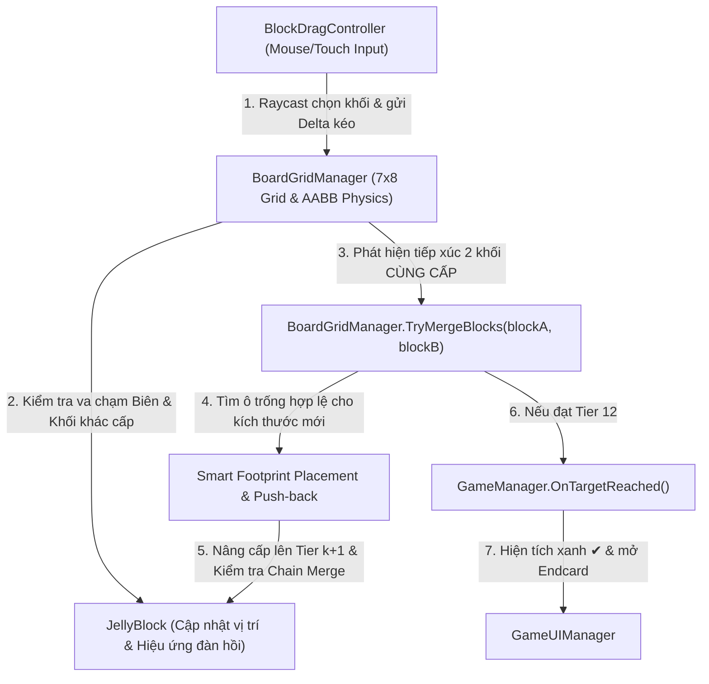

# Tài liệu Đặc tả Gameplay & Kỹ thuật Lập trình (GDD & TDD)
**Dự án:** 3D Emoji Jelly Slide & Merge (Clone từ Creative `eoOOBFUVPog` - Pets Harbor)  
**Engine mục tiêu:** Unity 6 (`6000.0.59f2`) | **Khung hình:** Portrait 9:16 (`1080 x 1920`)

---

## PHẦN 1: ĐẶC TẢ GAMEPLAY & DỮ LIỆU MÀN CHƠI (GAME DESIGN DATA)

### 1.1. Bố cục Không gian & Giao diện (9:16 Portrait)
1. **Top UI Header (Chiếm ~22% phía trên màn hình):**
   - **Góc trái trên:** Logo **Pets Harbor**.
   - **Giữa trên:** Bảng gỗ **"Slide items to merge"**.
   - **Góc phải trên:** Khung viền tím hiển thị **Target Block (Tier 12 - Khối Tím)**.
   - **Thanh Chuỗi Tiến Hóa (Evolution Bar):** Gồm 2 hàng $\times$ 6 ô hiển thị trực quan từ `Tier 1` $\rightarrow$ `Tier 12` nối nhau bằng mũi tên `→`.
2. **Board Khu vực Chơi (Chiếm ~75% giữa và dưới màn hình):**
   - **Khay gỗ 3D (Wooden Tray):** Lòng khay chia lưới **7 cột $\times$ 8 hàng** (`Cols = 7`, `Rows = 8`), bao quanh bởi 4 thành gỗ nổi cao.
   - **Camera 3D:** Perspective (`FOV = 42°`), đặt phía trên nhìn chúc xuống khay gỗ một góc nghiêng nhẹ ($\sim 68^\circ$ so với mặt phẳng ngang) để thấy rõ độ dày 3D của khối thạch và thành khay.
3. **Endcard / Win State (00:29 – 00:32):**
   - Khi tạo ra khối `Tier 12 (Tím)` trên bàn cờ $\rightarrow$ hiện dấu tích xanh **`✔`** tại khối Tím (`00:29`), dừng 1.2 giây rồi bung màn hình chiến thắng **Pets Harbor Endcard** kèm nút **Play Again**.

---

### 1.2. Bảng Thông số Chuỗi 12 Cấp độ Khối thạch (`TierConfigData`)

Quy tắc cốt lõi: **2 khối cùng cấp $k$ chạm nhau $\rightarrow$ Hợp nhất thành 1 khối cấp $k+1$**.

| Tier | Tên định danh | Màu chính (Hex) | Kích thước Lưới (`W x H`) | Kiểu Biểu cảm (Emoji Face ID) | Giá trị ($2^{k-1}$) |
| :---: | :--- | :---: | :---: | :--- | :---: |
| **1** | `T01_Orange` | `#E86A17` | `1 x 1` | `AngryFrown` (Cau mày, miệng mếu) | `1` |
| **2** | `T02_Peach` | `#E5A985` | `1 x 1` | `HappySmile` (Mắt cười, miệng cười mở) | `2` |
| **3** | `T03_Yellow` | `#F5C418` | `1 x 1` | `WinkCat` (Nháy mắt trái, miệng `:3`) | `4` |
| **4** | `T04_Brown` | `#8C583A` | `2 x 1` | `CalmSmile` (Nhắm mắt `u_u`, mỉm cười) | `8` |
| **5** | `T05_Green` | `#68E34B` | `2 x 1` | `WorriedSweat` (Mày lo lắng, miệng lượn) | `16` |
| **6** | `T06_Red` | `#E61C24` | `2 x 2` | `SquintCat` (Mắt `>_<`, miệng `:3`) | `32` |
| **7** | `T07_Magenta` | `#E6007E` | `2 x 2` | `GrumpyZigzag` (Mày dữ, miệng răng cưa) | `64` |
| **8** | `T08_SkyBlue` | `#8CD3E8` | `2 x 2` | `SurprisedO` (Mắt tròn `O_O`, miệng chữ O) | `128` |
| **9** | `T09_GoldenTan` | `#E8BE6B` | `2 x 2` | `AngryShout` (Mắt đỏ dữ, miệng há to) | `256` |
| **10** | `T10_MintCyan` | `#8CE8C8` | `3 x 2` | `SadPuppy` (Mắt buồn rưng rưng, miệng mếu) | `512` |
| **11** | `T11_LimeGreen` | `#A8E84B` | `3 x 2` | `LaughSquint` (Mắt `>_<`, miệng há cười lớn) | `1024` |
| **12** | `T12_PurpleGoal` | `#A626E8` | `3 x 3` | `CuteWinkGoal` (Mắt nháy `o_<`, miệng `:3`) | `2048` |

---

### 1.3. Dữ liệu Khởi tạo Màn chơi (`InitialLevelSpawnData` tại `00:00`)

Hệ tọa độ lưới:
- `col` $\in [0..6]$ (Từ Trái sang Phải).
- `row` $\in [0..7]$ (Từ Trên xuống Dưới).
- Mỗi khối được định vị bằng ô góc **Trái-Trên** `(col, row)` và chiếm vùng `[col .. col + W - 1] x [row .. row + H - 1]`.

```csharp
// Dữ liệu chuẩn 27 khối tại 00:00 (Tổng điểm = 2048 = đúng 1 khối Tier 12)
public static readonly BlockSpawnInfo[] InitialLevelLayout = new BlockSpawnInfo[]
{
    // --- Hàng 0..1 ---
    new BlockSpawnInfo(tier: 8,  col: 0, row: 0), // SkyBlue (2x2) chiếm [0..1, 0..1]
    new BlockSpawnInfo(tier: 1,  col: 2, row: 0), // Orange  (1x1)
    new BlockSpawnInfo(tier: 3,  col: 3, row: 0), // Yellow  (1x1)
    new BlockSpawnInfo(tier: 2,  col: 4, row: 0), // Peach   (1x1)
    new BlockSpawnInfo(tier: 9,  col: 5, row: 0), // Tan     (2x2) chiếm [5..6, 0..1]
    new BlockSpawnInfo(tier: 4,  col: 2, row: 1), // Brown   (2x1) chiếm [2..3, 1]
    new BlockSpawnInfo(tier: 3,  col: 4, row: 1), // Yellow  (1x1)

    // --- Hàng 2 ---
    new BlockSpawnInfo(tier: 1,  col: 0, row: 2), // Orange  (1x1)
    new BlockSpawnInfo(tier: 2,  col: 1, row: 2), // Peach   (1x1)
    new BlockSpawnInfo(tier: 3,  col: 2, row: 2), // Yellow  (1x1)
    new BlockSpawnInfo(tier: 5,  col: 3, row: 2), // Green   (2x1) chiếm [3..4, 2]
    new BlockSpawnInfo(tier: 3,  col: 5, row: 2), // Yellow  (1x1)
    new BlockSpawnInfo(tier: 2,  col: 6, row: 2), // Peach   (1x1)

    // --- Hàng 3..4 ---
    new BlockSpawnInfo(tier: 11, col: 0, row: 3), // Lime    (3x2) chiếm [0..2, 3..4]
    new BlockSpawnInfo(tier: 2,  col: 3, row: 3), // Peach   (1x1)
    new BlockSpawnInfo(tier: 1,  col: 3, row: 4), // Orange  (1x1)
    new BlockSpawnInfo(tier: 10, col: 4, row: 3), // Cyan    (3x2) chiếm [4..6, 3..4]

    // --- Hàng 5 ---
    new BlockSpawnInfo(tier: 2,  col: 0, row: 5), // Peach   (1x1)
    new BlockSpawnInfo(tier: 3,  col: 1, row: 5), // Yellow  (1x1)
    new BlockSpawnInfo(tier: 2,  col: 2, row: 5), // Peach   (1x1)
    new BlockSpawnInfo(tier: 4,  col: 3, row: 5), // Brown   (2x1) chiếm [3..4, 5]
    new BlockSpawnInfo(tier: 3,  col: 5, row: 5), // Yellow  (1x1)
    new BlockSpawnInfo(tier: 1,  col: 6, row: 5), // Orange  (1x1)

    // --- Hàng 6..7 ---
    new BlockSpawnInfo(tier: 5,  col: 2, row: 6), // Green   (2x1) chiếm [2..3, 6]
    new BlockSpawnInfo(tier: 3,  col: 4, row: 6), // Yellow  (1x1)
    new BlockSpawnInfo(tier: 6,  col: 5, row: 6), // Red     (2x2) chiếm [5..6, 6..7]
    new BlockSpawnInfo(tier: 3,  col: 3, row: 7), // Yellow  (1x1) <- Khối bàn tay kéo đầu tiên
};
```

---

## PHẦN 2: KIẾN TRÚC HỆ THỐNG & CẤU TRÚC CODE (SYSTEM ARCHITECTURE)

### 2.1. Cấu trúc Thư mục trong Unity 6
```text
Assets/
└── _Game/
    ├── Scenes/
    │   └── MainScene.unity
    ├── Scripts/
    │   ├── Core/
    │   │   ├── GameManager.cs              // Điều phối trạng thái Game (Playing, Won), Reset Level
    │   │   ├── TierDatabase.cs             // Chứa thông số 12 Tier & InitialLevelLayout
    │   │   └── BoardGridManager.cs         // Quản lý lưới 7x8, quy đổi tọa độ, kiểm tra va chạm & Merge
    │   ├── Gameplay/
    │   │   ├── JellyBlock.cs               // Component gắn trên mỗi khối thạch (Data, Visual, Squash & Stretch)
    │   │   └── BlockDragController.cs      // Xử lý Raycast chuột/cảm ứng, kéo mượt có chặn va chạm
    │   ├── Visuals/
    │   │   ├── ProceduralMeshGenerator.cs  // Tạo Mesh 3D khối thạch bo tròn (Rounded Box) & Khay gỗ
    │   │   ├── ProceduralEmojiDrawer.cs    // Vẽ Texture2D 12 khuôn mặt biểu cảm sắc nét bằng code
    │   │   └── MergeVFXManager.cs          // Hiệu ứng hạt nổ, dấu tích xanh ✔ khi đạt Tier 12
    │   ├── UI/
    │   │   ├── GameUIManager.cs            // Quản lý Header, Evolution Chain 12 cấp, Win Endcard
    │   │   └── TutorialHandController.cs   // Bàn tay 3D/UI hướng dẫn bước kéo đầu tiên
    │   └── Editor/
    │       └── GameSceneAutoBuilder.cs     // Editor Script tự động dựng toàn bộ MainScene & Prefabs
    ├── Materials/                          // Tự động sinh bởi Builder
    └── Prefabs/                            // Tự động sinh bởi Builder
```

### 2.2. Sơ đồ Luồng Tương tác giữa các Class


---

## PHẦN 3: THUẬT TOÁN CỐT LÕI ĐỂ LẬP TRÌNH (CORE ALGORITHMS)

### 3.1. Công thức Quy đổi Tọa độ Lưới $\leftrightarrow$ Tọa độ 3D (`World Space`)
- Gọi kích thước mỗi ô lưới là `cellSize = 1.0f` (đơn vị Unity).
- Khay gỗ nằm trên mặt phẳng `XZ` (với `Y = 0` là mặt đáy khay):
  - Trục `X` tương ứng với cột `col` (từ trái sang phải: `col = 0..6`).
  - Trục `Z` tương ứng với hàng `row` (từ trên xuống dưới: `row = 0` ở `Z` dương cao nhất, `row = 7` ở `Z` âm thấp nhất).
- Gốc tọa độ tâm của khay gỗ đặt tại `(0, 0, 0)`:
  - Tọa độ tâm thế giới `WorldPosition` của một khối có góc trái-trên tại `(gridX, gridY)` (lưu ý `gridX, gridY` có thể là số thực `float` trong lúc đang kéo) và kích thước `(W, H)`:
    $$X_{\text{world}} = \left(\text{gridX} + \frac{W}{2.0} - \frac{7.0}{2.0}\right) \times \text{cellSize}$$
    $$Z_{\text{world}} = \left(\frac{8.0}{2.0} - \left(\text{gridY} + \frac{H}{2.0}\right)\right) \times \text{cellSize}$$
  - Ngược lại, khi kéo chuột trên mặt phẳng `Y = blockHeight`, từ độ lệch $\Delta X_{\text{world}}, \Delta Z_{\text{world}}$ ta suy ra độ lệch trên hệ tọa độ lưới:
    $$\Delta \text{gridX} = \frac{\Delta X_{\text{world}}}{\text{cellSize}}, \quad \Delta \text{gridY} = -\frac{\Delta Z_{\text{world}}}{\text{cellSize}}$$

---

### 3.2. Thuật toán Kéo Trượt & Va chạm hộp AABB (`SlideWithCollision`)
Trong lúc người chơi giữ và kéo khối $A$:
1. Không cho phép khối $A$ nhảy cóc qua đầu các khối khác. Mỗi frame, chia vector di chuyển mong muốn $(\Delta x, \Delta y)$ thành các bước nhỏ (sub-steps $\le 0.1$ ô) và trượt độc lập trên từng trục $X$ rồi $Y$ (Axis-Separated Swept AABB):
2. **Kiểm tra Biên khay gỗ:**
   $$\text{gridX} \in [0, \, 7 - W_A], \quad \text{gridY} \in [0, \, 8 - H_A]$$
3. **Kiểm tra Va chạm với từng khối $B$ khác trên bàn cờ:**
   - Hộp bao của $A$: $[x_A + \text{pad}, \, x_A + W_A - \text{pad}] \times [y_A + \text{pad}, \, y_A + H_A - \text{pad}]$ (với $\text{pad} = 0.04$ để dễ lách qua khe hẹp).
   - **Trường hợp 1 ($B.\text{tier} \neq A.\text{tier}$ - Khác cấp):**
     - $B$ là vật cản cứng (Solid Obstacle). Nếu bước di chuyển làm hộp của $A$ giao với hộp của $B$, chặn (clamp) tọa độ của $A$ sát mép của $B$.
   - **Trường hợp 2 ($B.\text{tier} == A.\text{tier}$ - Cùng cấp):**
     - Ngay khi hộp của $A$ chạm hoặc giao nhẹ với hộp của $B$ (khoảng cách cạnh $\le 0.12$ ô) $\rightarrow$ **Kích hoạt ngay lập tức `ExecuteMerge(A, B)`**!
4. **Khi người chơi thả tay (`OnPointerUp`) mà chưa Merge:**
   - Làm tròn tọa độ của $A$ về ô nguyên gần nhất `(Mathf.RoundToInt(gridX), Mathf.RoundToInt(gridY))` không bị chồng lấp, và chạy tween mượt trong `0.08s` để các đường rãnh trên bàn cờ luôn thẳng hàng.

---

### 3.3. Thuật toán Đặt Khối Mới khi Tăng Kích thước (`SmartMergeFootprint`)
Khi khối $A$ (đang kéo) chạm vào khối $B$ (đứng yên) cùng cấp $k$, khối mới sinh ra có cấp $k+1$ và kích thước mới $(W_{\text{new}}, H_{\text{new}})$:

1. **Bước 1:** Giải phóng tạm thời vùng chiếm chỗ của cả $A$ và $B$ khỏi bàn cờ.
2. **Bước 2:** Xác định điểm tâm mong muốn (Anchor ưu tiên tại vị trí của khối đích $B$ và trung điểm $(A, B)$).
3. **Bước 3 (Tìm vị trí trống trực tiếp):**
   - Duyệt tất cả các tọa độ góc trái-trên `(c, r)` trong phạm vi $c \in [0 .. 7 - W_{\text{new}}]$, $r \in [0 .. 8 - H_{\text{new}}]$.
   - Chấm điểm ưu tiên cho từng `(c, r)`:
     $$\text{Score}(c, r) = \text{OverlapArea}(\text{Rect}_{\text{new}}, A \cup B) \times 10 - \text{Distance}(\text{Center}_{\text{new}}, \text{Center}_B)$$
   - Nếu tìm được `(c, r)` có **0 ô bị cản** bởi các khối còn lại $\rightarrow$ chọn `(c, r)` có điểm cao nhất!
4. **Bước 4 (Cơ chế Đẩy lùi tự động - Push/Compact nếu bị chèn ép):**
   - Nếu tại vị trí sát biên hoặc góc hẹp mà khối mới lớn hơn vùng trống của $A \cup B$ (ví dụ 2 khối $1\times1$ nằm dọc ghép thành khối $2\times1$ nằm ngang, hoặc $2\times2$ thành $3\times2$):
   - Tìm `(c, r)` có tổng diện tích các khối bị đè ít nhất (ưu tiên chỉ đè lên các khối nhỏ $1\times1$ hoặc $2\times1$) và tự động đẩy (dịch chuyển) các khối bị đè đó sang các ô trống kế bên.
5. **Bước 5 (Chain Merge - Hợp nhất Dây chuyền):**
   - Sau khi khối mới cấp $k+1$ xuất hiện (ví dụ tại `00:01 -> 00:02` khi 2 khối Vàng `T3` ghép thành Nâu `T4` ngay sát dưới khối Nâu `T4` có sẵn):
   - Nếu người chơi vẫn đang giữ kéo hoặc khối mới sinh ra nằm tiếp giáp trực diện với một khối cùng cấp $k+1$ theo hướng vừa kéo $\rightarrow$ tự động nối chuỗi hợp nhất lên cấp $k+2$ sau `0.15s`!

---

## PHẦN 4: ĐẶC TẢ HÌNH ẢNH 3D, SHADER & HIỆU ỨNG (VISUAL & PROCEDURAL SPECS)

Để project chạy hoàn chỉnh 100% ngay khi mở trong Unity 6 mà không bị lỗi thiếu model hay ảnh ngoài:

1. **Mesh Khối Thạch 3D (`ProceduralMeshGenerator`):**
   - Sinh Mesh hộp vát tròn cạnh (**Rounded Beveled Box**) theo đúng kích thước `(W * cellSize - gap, blockThickness, H * cellSize - gap)` với `gap = 0.06f` để giữa các khối có khe hở nhìn rõ từng viên thạch.
   - Đỉnh khối hơi phồng nhẹ tạo cảm giác thạch mềm (Jelly Pillow Top).
2. **Chất liệu Thạch Bóng (`Glossy Jelly Material`):**
   - Sử dụng Shader chuẩn của Unity 6 (hỗ trợ tự động cả URP `Universal Render Pipeline/Lit` và Built-in `Standard` fallback):
     - `Smoothness = 0.88f` (Bóng loáng bắt sáng mạnh).
     - `Metallic = 0.05f`.
     - Kết hợp Quad mặt biểu cảm (Emoji Face Decal) đặt sát mặt trên của khối thạch.
3. **Vẽ Texture 12 Biểu cảm Emoji & UI (`ProceduralEmojiDrawer`):**
   - Sinh `Texture2D (512x512, RGBA32)` bằng thuật toán vẽ hình học chống răng cưa (Anti-aliased Signed Distance Field / Bezier curves) cho:
     - Má hồng 2 bên (Blush).
     - Lông mày, mắt (mắt tròn, mắt nháy `>_<`, mắt buồn, mắt đỏ...), miệng (miệng cười, miệng mèo `:3`, miệng răng cưa `www`, miệng há) đúng 100% theo từng Tier trong bảng 1.2.
4. **Hiệu ứng Đàn hồi Thạch (`Jelly Squash & Stretch`):**
   - Khi khối đang được kéo: Nghiêng nhẹ và kéo giãn 5% theo vận tốc di chuyển.
   - Khi vừa Merge xong: Chạy hàm dao động tắt dần trên `localScale`:
     $$S_x(t) = 1 + 0.28 e^{-8t} \sin(28t), \quad S_z(t) = 1 + 0.28 e^{-8t} \sin(28t), \quad S_y(t) = 1 - 0.22 e^{-8t} \sin(28t)$$

---

## PHẦN 5: CHECKLIST TRIỂN KHAI CÁC BƯỚC TIẾP THEO

- [x] **Bước 1:** Phân tích video & lập Tài liệu Đặc tả Gameplay + Kỹ thuật ([Step1_Game_Analysis.md](file:///d:/Company/Cscmobi/Projects/G23/REA/Demo%20Game%20From%20Creative/Step1_Game_Analysis.md)).
- [x] **Bước 2:** Khởi tạo cấu trúc Project Unity 6 (`Pets Harbor`) và kết nối `unityMCP`.
- [x] **Bước 3:** Code bộ sinh Mesh 3D (Khay gỗ, Khối thạch bo góc), Material bóng và bộ vẽ 12 khuôn mặt Emoji + UI Header.
- [x] **Bước 4:** Code hệ thống `BoardGridManager`, `JellyBlock`, `BlockDragController` (Kéo trượt va chạm AABB + Smart Merge + Chain Merge).
- [x] **Bước 5:** Code `GameUIManager` (Bảng gỗ, Evolution Bar 12 cấp, Target Box, Bàn tay hướng dẫn, Endcard Pets Harbor).
- [x] **Bước 6:** Chạy `GameSceneAutoBuilder` qua `unityMCP` để tự động dựng Scene hoàn chỉnh và kiểm tra biên dịch `0 lỗi`.
